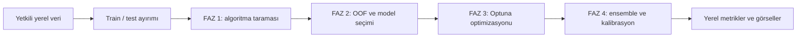

<div align="center">

# 🧬 BioSense AI

**Genetik varyant sınıflandırması için çok aşamalı makine öğrenmesi**

Optuna · SHAP · Ensemble · Kalibrasyon · Streamlit

**Kaynak kod deposu · TEKNOFEST veri seti içermez**

[Hızlı başlangıç](#hızlı-başlangıç) · [Kullanım](docs/USAGE.md) · [Geliştirme geçmişi](docs/DEVELOPMENT_HISTORY.md) · [Veri politikası](docs/DATA_POLICY.md)

</div>

---

BioSense AI, varyantların iki sınıflı sınıflandırılması üzerinde geliştirilen bir araştırma projesidir. Farklı algoritmaları tarar, seçilen modellerin hiperparametrelerini optimize eder ve tek model ile ensemble sonuçlarını karşılaştırır. KANSER, CFTR, PAH ve MASTER çalışma profilleri bulunur.

Bu depo, uzun bir yerel geliştirme sürecinin düzenlenmiş kaynak kod sürümüdür. **25 gerçek eski eğitim kodu kopyası ayrı arşiv commit'leri olarak korunmuştur.** Commit'ler sonradan aktarılmıştır; özgün dosyaların Mayıs–Haziran 2026 tarihleri ve SHA-256 özetleri [kaynak tarihçesinde](docs/source-history.json) kayıtlıdır. Dosya değiştirme tarihleri kesin geliştirme tarihi olarak sunulmaz.

> **Veri paylaşımı:** TEKNOFEST verileri, bunların alt kümeleri, dönüştürülmüş kopyaları, satır bazlı tahminleri, eğitim çıktıları ve model dosyaları bu depoda bulunmaz. Demo yalnızca rastgele üretilmiş yapay kayıtlar kullanır.

## Neler içerir?

- **İki optimizasyon seçeneği:** v7.9 tabanlı F2 ve v7.9x tabanlı F1 eğitim kodu.
- **Algoritma taraması:** XGBoost, LightGBM, CatBoost, Random Forest, Extra Trees, lojistik regresyon, SVM ve kNN.
- **Çok aşamalı eğitim:** geniş tarama, OOF değerlendirme, model seçimi, derin optimizasyon ve ensemble/kalibrasyon adımları.
- **Açıklanabilirlik:** SHAP özellik değerlendirmesi ve yerel görsel çıktılar.
- **Yerel değerlendirme arayüzü:** etiketli testte metrikler; etiketsiz testte tahmin üretimi.
- **Veri koruması:** yalnızca izin verilen dosyalar için Git takibi, commit/push kontrolleri ve GitHub Actions doğrulaması.



## Hızlı başlangıç

Python **3.13** ile hazırlanmıştır. Aşağıdaki komutlar depo kökünde çalıştırılır.

```powershell
python -m venv .venv
.\.venv\Scripts\Activate.ps1
python -m pip install -r requirements.txt
git config core.hooksPath .githooks
python scripts/make_demo_data.py
python -m streamlit run apps/evaluate.py
```

Arayüzde `data/demo/YARISMA_TRAIN_KANSER.csv` dosyasını TRAIN, `data/demo/synthetic_test.csv` dosyasını TEST olarak seç. JSON yüklemeden **Tek Model → logistic** ile deneyebilirsin. Hedef kolon `Label`, ID kolonu `Variant_ID` olmalıdır. Etiketsiz akış için `synthetic_unlabeled.csv` kullanılır.

Demo eğitim dosyasının adı, mevcut eğitim koduyla uyum için korunmuştur; **dosyanın bütün satırları yapaydır ve TEKNOFEST verisinden türetilmemiştir.** Üretilen CSV'ler Git tarafından yok sayılır.

Arayüzün model yardımcılarını ve ilk açılışını sentetik veriyle kontrol etmek için:

```powershell
python scripts/smoke_demo.py
```

## Kendi yetkili verinle eğitim

```powershell
python train.py pah --data-dir "D:/private/biosense" --objective f2 --mode fast --device cpu --dry-run
python train.py pah --data-dir "D:/private/biosense" --objective f2 --mode fast --device cpu
```

İlk komut yalnızca yolları doğrular. İkinci komut eğitimi başlatır. Örnekte giriş dosyası `YARISMA_TRAIN_PAH.csv`, çıktı klasörü `runs/pah_f2/` olur. **FAST modu da çok sayıda eğitim çalıştırır; hızlı arayüz denemesi için sentetik demo tercih edilir.** F1 ve F2 çalışmaları ayrı çıktı klasörlerine yazılır.

Tam komutlar, dosya şeması ve çalışma sınırları: [Kullanım kılavuzu](docs/USAGE.md).

## Depo düzeni

```text
biosense-ai/
├── train.py                    # Giriş/çıktı yollarını ayıran başlatıcı
├── pipelines/
│   ├── train_f2.py             # v7.9 tabanlı eğitim
│   └── train_f1.py             # v7.9x tabanlı eğitim
├── apps/evaluate.py            # Streamlit değerlendirme arayüzü
├── scripts/                    # Sentetik demo ve paylaşım kontrolleri
├── tests/                      # Veri koruması ve başlatıcı testleri
├── docs/                       # Kullanım, kaynak geçmişi, doğrulama
├── .githooks/                  # Commit / push öncesi kontroller
└── .github/workflows/ci.yml    # Kaynak ve geçmiş kontrolü
```

## Doğrulama ve sınırlar

```powershell
python -m unittest discover -s tests -v
python scripts/check_public_repo.py --history
```

Bu yayına hazırlık sırasında yarışma verisiyle tam eğitim tekrarlanmamıştır. Sentetik kontroller, yazılım akışını sınar; bilimsel performans, klinik geçerlilik veya yarışma başarısı kanıtı değildir. Doğrulanmamış eski skorlar README'ye taşınmamıştır. Mevcut araştırma kodu büyük ölçüde korunmuştur; tam metodoloji denetimi ve kapsamlı modülerleştirme ayrı işlerdir.

[Doğrulama kaydı](docs/VALIDATION.md) · [Katkı kuralları](CONTRIBUTING.md) · [Haklar ve kapsam](NOTICE.md)
